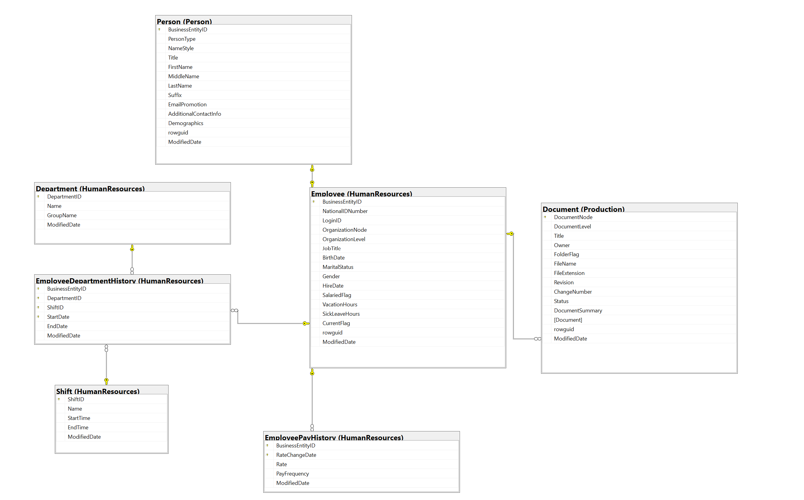

# 🏢 Enterprise HR Analytics Dashboard

---

An end-to-end Enterprise HR Analytics solution built using **SQL Server** for database extraction, data transformation, and data cleaning, and **Power BI** for interactive workforce and compensation visualization. This dashboard provides deep, data-driven insights into employee demographics, compensation structures, tenure metrics, and departmental performance.

---

## 🚀 Project Overview

The primary objective of this project is to transform raw human resources data into clean, intuitive, and actionable business insights. Starting from an enterprise-level relational database, the project extracts, cleans, models, and visualizes HR data to track headcount trends, salary distributions across departments, sick leave metrics, and individual employee profiles using modern business intelligence standards.

---

## 🛠️ Tools & Technologies Used

- **SQL Server / SSMS:** Enterprise database exploration, data preparation, extraction, joining tables, and executing transformation queries via SQL (`Project HR AdventureWorks2019.sql`).
- **Power BI:** Data modeling, star schema architecture, interactive dashboard design, complex DAX measures, and custom tooltip integrations.
- **Figma:** Dashboard UI/UX framing, custom background design, and color palette alignment.

---

## 🏗️ Data Pipeline & Architecture

### 1️⃣ Source Enterprise Relational Database (Full Schema)
The analysis began by examining the enterprise-wide relational database containing all organizational entities and cross-departmental relationships.

---

### 2️⃣ HR Domain Extraction & Selection
From the full enterprise schema, the core Human Resources entities (Employees, Departments, Salaries, Shifts, and Person records) were identified and isolated using targeted SQL queries.

---

### 3️⃣ Data Cleaning, Transformation & SQL Processing
Using SQL Server (`Project HR AdventureWorks2019.sql`), raw database tables were queried, transformed, and structured:
- Cleaned and normalized employee demographic data, titles, and pay histories.
- Handled historical department changes and active status filtering.
- Validated relationships and primary/foreign keys before importing into Power BI.

---

### 4️⃣ Power BI Data Modeling (Star Schema)
Inside Power BI, a high-performance **Star Schema** data model was constructed by joining optimized fact tables with dimension tables:

- **Fact Tables:** `Fact_Employee`, `Fact_PayHistory`
- **Dimension Tables:** `Dim_Department`, `Dim_Shift`, `Dim_Date`
- **Measures Table:** Centralized `Dax_Measure` table containing all core business logic, including Average Tenure, Hourly Rates, Salary Growth %, and Total Employees.

---

## 🖥️ Dashboard Pages & Features

### 1️⃣ Home Page
A clean, professional landing interface designed with smooth navigation buttons and project branding.

### 2️⃣ HR Overview
A high-level overview displaying key workforce metrics including total employees (290), gender distribution, age groups, top job titles, and department breakdowns.

### 3️⃣ Compensation & Workforce
A deep-dive financial and workforce page focusing on pay metrics, salary growth percentages, highest vs. lowest pay rates, and sick leave hours across departments.

### 4️⃣ Employee Details
A structured matrix view showcasing individual employee records, IDs, specific job titles, years of service, and precise compensation rates.

### 5️⃣ Interactive Tooltips
Custom-built dynamic tooltip page (`Tooltip_Department`) providing contextual metrics and micro-visualizations on hover.

---

## 💡 Business Recommendations (توصيات الإدارة)

بناءً على التحليلات المستخرجة من الداشبورد، يمكن للإدارة اتخاذ القرارات الاستراتيجية الآتية:

- **موازنة الرواتب (Compensation Equity):** وجود فجوة واسعة بين أعلى معدل أجور وأقل معدل يتطلب مراجعة هياكل الدرجات الوظيفية (Rate Bands) لتحقيق العدالة الداخلية وتقليل معدلات التسرب الوظيفي.
- **إدارة الإجازات والغياب (Sick Leave Optimization):** مراقبة ساعات الإجازات المرضية المرتفعة في بعض الأقسام لدراسة بيئة العمل وتحسين جودة ظروف السلامة المهنية.
- **تطوير القوى العاملة (Workforce Planning):** التركيز على الفئات العمرية الغالبة في الأقسام التشغيلية لضمان وجود خطط إحلال واضحة (Succession Planning) للمناصب الحرجة.

---

### 👤 Created By:
**Ebrahim Mustafa** — *Data Analyst & BI Analyst*
